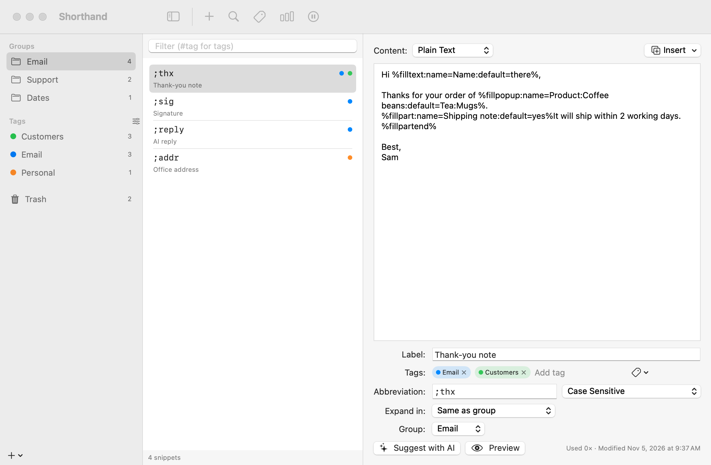
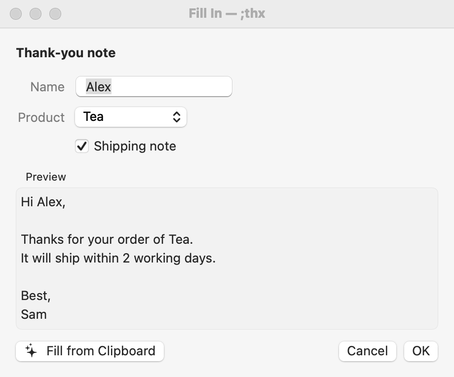
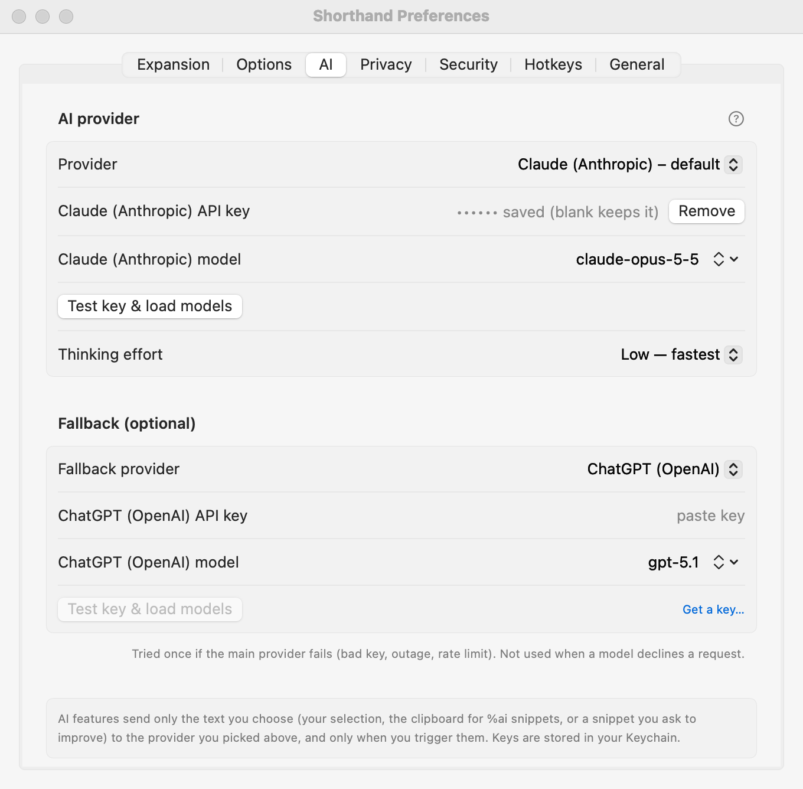
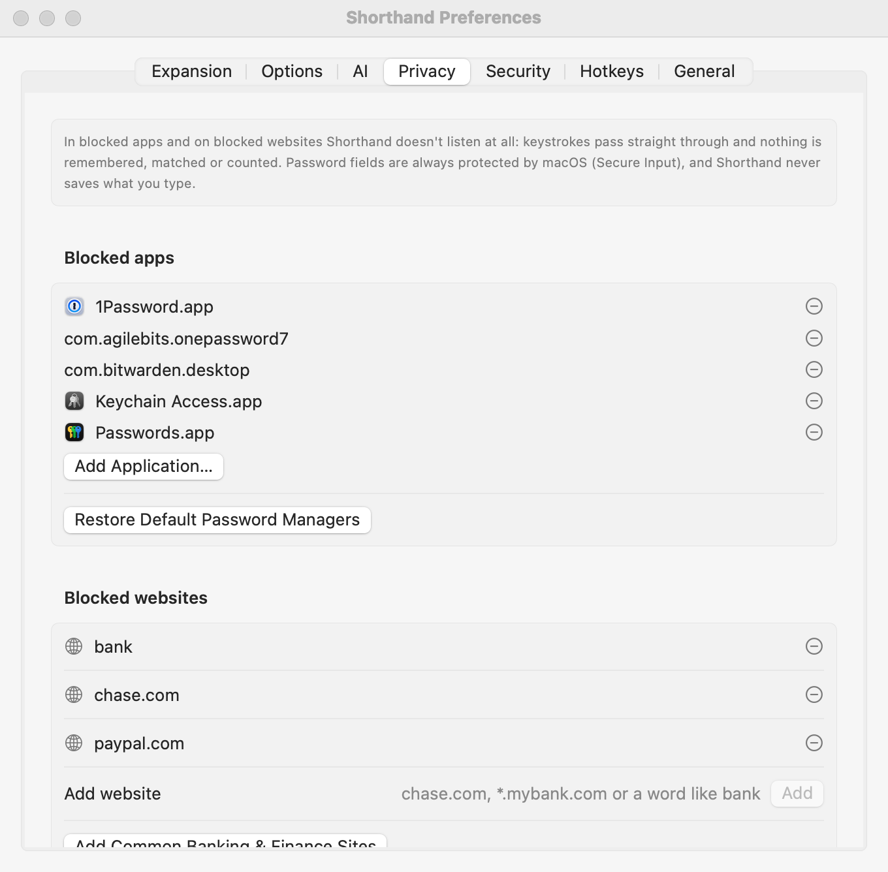
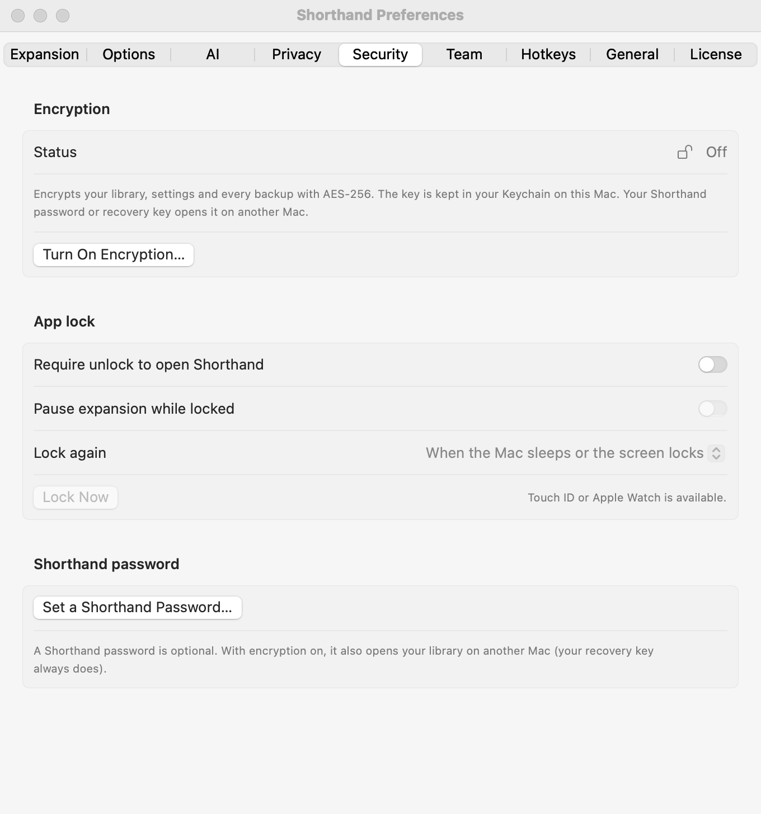

# Shorthand

**A native Apple Silicon text expander for macOS.** Type a short abbreviation and get your full snippet, in any app. Shorthand imports your TextExpander library, and adds fill-ins, AI, tags, a privacy blocklist, encryption and an app lock.

<picture><source media="(prefers-color-scheme: dark)" srcset="images/main-window-dark.png"></picture>

**[⬇ Download the latest version](https://github.com/jkirker/shorthand-text-expander-mac/releases/latest)** · [Help](https://jkirker.github.io/shorthand-text-expander-mac/) · [Features](FEATURES.md) · [What's new](CHANGELOG.md) · [Privacy](PRIVACY.md) · [Security](SECURITY.md) · [License](LICENSE.md)

Current version: **1.5.4** · macOS 14 or later · Apple Silicon · signed with a Developer ID and notarized by Apple.

## Highlights
- **Everything TextExpander 5 does:** abbreviations, fill-ins (text, choices, optional sections), dates and date math, the clipboard, nested snippets, keys and cursor placement, script snippets, groups, per-app rules, search, statistics, backups and sync folders.
- **Imports your TextExpander library** (`Settings.textexpander`, group files, backups, CSV) and carries over your lifetime "characters saved".
- **AI:** rewrite any selected text (⌃⌥A), let AI write part of a snippet (`%ai:…%`), or turn text into a snippet. 12 providers (Claude, ChatGPT, Gemini, Groq, Mistral, local models and more) with automatic fallback.
- **More than TextExpander:** calculations and conditional text, multi-select, tags with a Tag Manager, a Trash with Put Back, and ⌘Z for library changes.
- **Privacy blocklist:** Shorthand stops listening entirely in password managers and on sites you block, such as your bank. It also asks before working in a new app.
- **Encryption and app lock (optional):** AES-256 encryption for your snippets and backups, plus Touch ID, Apple Watch or password to open Shorthand.
- **Automatic updates,** signed and verified.
- **Looks at home in light and dark mode.**

<table><tr>
<td><picture><source media="(prefers-color-scheme: dark)" srcset="images/fill-in-dark.png"></picture></td>
<td><picture><source media="(prefers-color-scheme: dark)" srcset="images/settings-ai-dark.png"></picture></td>
</tr><tr>
<td><picture><source media="(prefers-color-scheme: dark)" srcset="images/settings-privacy-dark.png"></picture></td>
<td><picture><source media="(prefers-color-scheme: dark)" srcset="images/settings-security-dark.png"></picture></td>
</tr></table>

## Install
1. Download **Shorthand-1.5.4.dmg** from [Releases](https://github.com/jkirker/shorthand-text-expander-mac/releases/latest).
2. Open it and drag **Shorthand** onto the **Applications** shortcut, then open Shorthand from Applications.
3. Accept the license agreement, then follow the setup: grant **Accessibility**, then import from TextExpander if you like.

New versions install themselves (Shorthand ▸ Check for Updates…).

## Help
The complete user guide is online at **[jkirker.github.io/shorthand-text-expander-mac](https://jkirker.github.io/shorthand-text-expander-mac/)**, and inside the app under Help ▸ Shorthand Help (⌘?).

## License
Shorthand is provided **"as is", without warranty of any kind**. See [LICENSE.md](LICENSE.md). You accept it on first launch.

© 2026 John Kirker · Like it? [Buy me a coffee on Ko-fi](https://ko-fi.com/kirkerplugins)

This repository hosts releases, the update feed (`appcast.xml`, attached to each release) and the public documentation. The source code is private.
