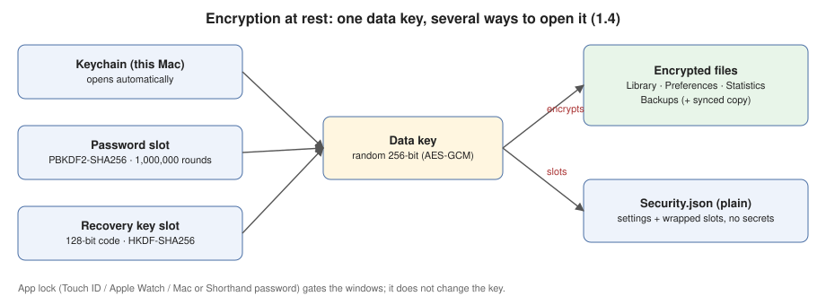

# Shorthand — Security Design (encryption at rest + app lock)

## 1. Goals
- Snippets, settings and backups are unreadable outside Shorthand: by other apps, in copied files, on sync servers.
- Opening Shorthand can require Touch ID, Apple Watch, or a Mac or Shorthand password.
- Never lose data: an encrypted file this Mac can't open is **locked**, never "damaged".
- Everything is optional, and offered once ("Protect Shorthand?").

## 2. Threat model
| Threat | Protected? | How |
|---|---|---|
| Synced copy read on Dropbox's or iCloud's servers, or in a leaked account | Yes | AES-256-GCM. The key never leaves the Mac except wrapped in slots. |
| Other apps or tools reading files in `~/Library/Application Support/Shorthand` | Yes (encryption on) | Same |
| Copied or stolen backups | Yes | Backups are encrypted too |
| Someone at your unlocked Mac opening Shorthand | Yes (app lock on) | LocalAuthentication gate; windows close on relock |
| Malware already running as you while Shorthand is unlocked | **No** | Snippets must be readable in memory to expand. No text expander can prevent this. |
| Stolen, powered-off Mac | Already covered | FileVault (on for this user) |
| Forgotten password **and** lost recovery key | **Unrecoverable by design** | Nobody can open the files, including the developer |

## 3. Cryptography
- **Data key:** 256 random bits (`SymmetricKey(size: .bits256)`).
- **File encryption:** AES-256-GCM (CryptoKit) with a fresh random 96-bit nonce per seal. Stored as the combined representation (nonce ‖ ciphertext ‖ tag). The header (`format|version|keyID`) is authenticated as AAD, so the keyID can't be swapped.
- **Password slot:** PBKDF2-HMAC-SHA256 with **1,000,000** rounds (0.14 s measured on this Mac) and a 16-byte random salt. The password is normalized to NFC first. The derived key AES-GCM-seals the data key.
- **Slot validation:**
  - A slot is rejected unless the salt is 16 bytes and the wrapped key is 60 bytes.
  - Password slots must use 100k–10M rounds, and recovery slots 0.
  - The CommonCrypto status is checked.

  Without these checks, a planted 0-round slot would derive an all-zero key that opens with any password. This was found in review and is fixed and tested.
- **Recovery slot:**
  - The code is 128+ random bits encoded as 26 characters from a 32-symbol alphabet with no 0/O/1/I, shown as `XXXX-XXXX-…`.
  - The key is derived with HKDF-SHA256 (16-byte salt, info `shorthand-recovery-v1`); the code's high entropy makes slow stretching unnecessary.
  - Input is normalized to uppercase with dashes and spaces removed.
- **Keychain:** a generic password, service `com.kirker.shorthand`, account `vault-key-<keyID>`, created by Shorthand's Developer ID signature. Other apps get a macOS prompt.

## 4. File formats
- **Encrypted file:** `{"format":"shorthand-encrypted","version":1,"keyID":…,"slots":[…],"box":…}`. Schema: [encrypted-envelope.schema.json](schemas/encrypted-envelope.schema.json). Every encrypted file carries the slots, so a synced library can be opened on another Mac.
- **`Security.json`:** always plain. Holds encryption on/off, keyID, slots, lock options and the "offered" flag. No secrets. Schema: [security.schema.json](schemas/security.schema.json).
- **Exports stay plain** by design: TextExpander group export.
- **`diagnostics.log`** stays plain and records only events: "encryption on", "unlocked", and so on.

## 5. Loading rules (data safety)
`LibraryStorage.loadResult` returns:
- **ok:** the file was read (and decrypted if needed).
- **missing:** no file.
- **locked(envelope):** encrypted with a key this Mac doesn't have. AppState enters **`dataLocked`**:
  - No saves (library, settings, statistics), no backups, no Trash purge.
  - Expansion is paused.
  - Unlock asks for the password or recovery key. `adopt` stores the key and re-encrypts this Mac's own files, then everything reloads.
- **unreadable:** genuinely damaged. Only then is the library moved aside (unchanged since 1.1).

## 6. Operations and their ordering
| Operation | Order (interruption-safe) |
|---|---|
| Turn on | 1. **Refuse if the sync folder's library is already encrypted by another Mac with a different key**; unlock with that Mac's secret instead, so both Macs share one key. 2. Create the key, recovery code and slots. 3. Show the recovery key; Done waits for "I've saved it". 4. Save to Keychain (add or update) and read it back. 5. Write `Security.json`, **retiring** any previous key. 6. Save files encrypted; if that fails, roll everything back. 7. Re-encrypt backups. |
| Turn off | 1. Authenticate. 2. Save plain and **check that the library file is no longer encrypted**; if not, stay on and say so. 3. Decrypt backups. 4. Write `Security.json`, with the key **retired** (kept in the Keychain for reading only). Slots stay as the app-lock password verifier. |
| Change password / new recovery key | 1. Verify. 2. Make a new slot for the same data key. 3. **Bump the slot generation.** 4. Re-save files. Other Macs adopt slots with a higher generation from the synced envelope. Older copies keep the old slot, so this **isn't revocation**: someone holding an old copy and the old secret can still open that copy. |
| Adopt (another Mac) | 1. Unwrap with the password or recovery key. 2. Save to Keychain; if that fails, unlock anyway for this session and warn. 3. Write `Security.json`, retiring this Mac's previous key. 4. Re-encrypt this Mac's settings, stats, backups **and current library**. When switching sync folders, the key is adopted only after the user picks "Use Library in Folder". |
| Reload with the right key that won't open | **Unreadable (damaged), not locked:** set aside, restore a backup. |
| Unlock while the library isn't downloaded yet | **Stays locked.** No empty library is ever saved over a missing synced file. |
| Restore backup | A backup made under an earlier key is opened with the password or recovery key that was valid then. |

## 7. App lock
- **Unlock method:** `LAContext.evaluatePolicy`.
  - Default policy `.deviceOwnerAuthentication`: Touch ID, Apple Watch or the Mac password.
  - With "use Shorthand password": `.deviceOwnerAuthenticationWithBiometricsOrWatch`, or the Shorthand password checked against the slots.
- **Gated:**
  - the main window, Settings, Setup, Tag Manager, Statistics, Create Snippet and the Search panel
  - the menu bar snippet lists, which are hidden
  - Help stays available
- **Relock:**
  - `NSWorkspace.willSleep`, `screensDidSleep` and `sessionDidResignActive`
  - the distributed notification `com.apple.screenIsLocked`
  - idle time over N minutes, checked every 1.5 s
  - or only at quit

  Relocking closes the protected windows.
- **Expansion pause:** optional. The event tap reads only the cached `expansionPaused` flag and never calls LocalAuthentication.
- **At launch:** no prompt if locked. A reminder bubble appears only when expansion is paused.

## 8. Verification
- **Unit tests** (`VaultTests`): seal/open, wrong key, slots, loosely typed recovery input, locked vs unreadable, re-encrypt/decrypt, KDF timing.
- **`--security-selftest`** (24 checks, real app code, throwaway data):
  - encrypting everything, including backups
  - "second Mac" locked handling with no overwrite
  - wrong password rejected
  - recovery unlock
  - password change
  - turning off back to plain
- **`--security-selftest-prepare` + `--security-selftest-launch`** (9 checks): a fresh launch with encrypted files and no key starts locked, substitutes nothing, saves and backs up nothing, then unlocks with a loosely typed recovery key.

## 8b. Update integrity (1.5)
Sparkle installs an update only if it carries a valid EdDSA signature from the developer's key (public key in Info.plist), **and** is signed by the same Developer ID. The feed comes over HTTPS from GitHub. The private signing key lives only in the developer's Keychain and must be backed up.

## 9. Known limits
- **Mixed versions while syncing:** Shorthand 1.3 or older can't read an encrypted synced library. It treats it as damaged, sets it aside and saves a starter library, which a 1.4 Mac then loads. Recoverable from the set-aside file or backups. Turning encryption on with a sync folder therefore first asks you to confirm every Mac is on 1.4+.
- Retired keys stay in the Keychain so older files remain readable. Removing Shorthand's Keychain items in Keychain Access deletes them.
- A separate Shorthand password protects the app lock and other Macs. On this Mac, the data key is still opened automatically from the Keychain, so expansion can work without a prompt.